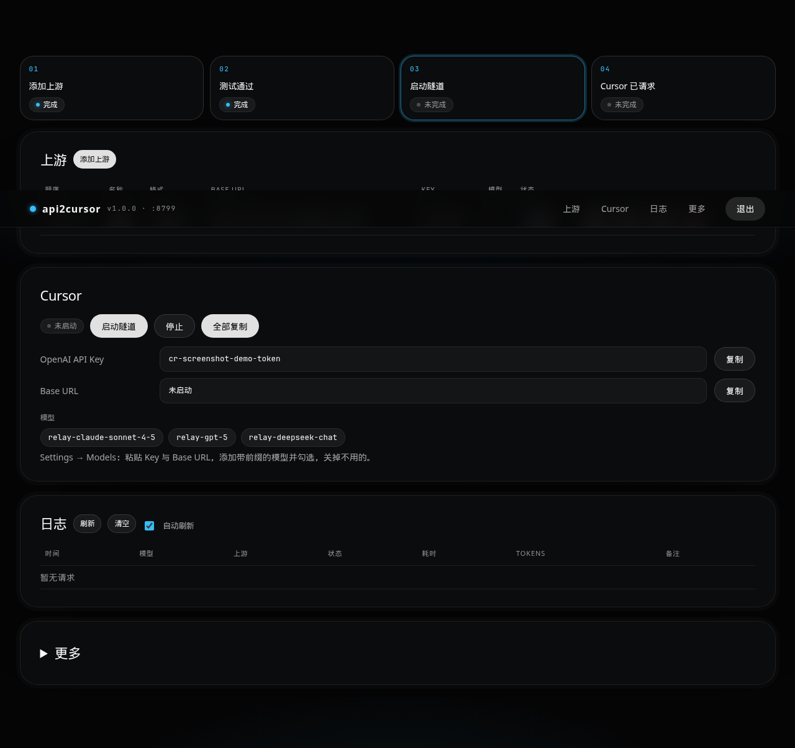

# api2cursor

**把任意模型接进 Cursor。** 一个零依赖的本地代理：把中转站、Anthropic Claude、Google Gemini、Azure OpenAI、OpenAI Responses API 以及 Ollama / LM Studio 等本地模型，统一变成 Cursor 认识的 OpenAI 接口，再通过 Cursor 的 **Override OpenAI Base URL** 接入。附带网页配置界面。



- 单文件 `server.mjs` + `admin.html`，只用 Node 内置模块，**没有 npm 依赖**，Node 18+ 即可运行（macOS / Windows / Linux）
- 网页配置页：增删改上游、获取模型、一键测试、开关隧道、复制 Cursor 设置、查看请求日志，**改动即时生效**
- 支持 5 种上游格式，流式 / 非流式 / 工具调用（Agent 模式）全部双向翻译
- 模型别名、按模型指定上游、5xx/429/超时自动切换备用上游
- 推理强度：模型名加 `-low` / `-medium` / `-high` 后缀即可
- 内置 cloudflared 快速隧道管理，打印出要粘贴进 Cursor 的三项内容

---

## 为什么需要它

Cursor 允许你填自己的 OpenAI Key 和 Base URL，但直接填中转站常遇到三个坑：

1. **Cursor 访问不到 localhost**：请求是从 Cursor 自己的服务器发出的，所以本地 / 内网地址会被拦，必须有公网 HTTPS 地址 → 本项目内置 cloudflared 隧道。
2. **模型名被截走**：`claude-`、`gpt-` 开头的名字会被 Cursor 当成它自带的模型，请求根本不会发到你的地址 → 本项目给模型名加前缀（默认 `relay-`），转发前再去掉。
3. **接口格式不兼容**：Cursor 只会说 OpenAI Chat Completions，而 Claude、Gemini、Azure、新的 OpenAI Responses 接口各不相同 → 本项目负责双向翻译，包括流式输出和工具调用。

## 快速开始

### 1. 启动

需要 [Node.js](https://nodejs.org/) 18 或更高版本。

```bash
git clone https://github.com/lintsinghua/api2cursor.git
cd api2cursor

# macOS / Linux：自动下载 cloudflared 并开隧道
./start.sh

# Windows：双击 start.bat，或
node server.mjs --tunnel
```

首次启动会在终端打印：

```
api2cursor 1.0.0 已启动: http://127.0.0.1:8787
管理页    : http://127.0.0.1:8787/admin  (仅本机可访问，隧道访问会返回 404)
管理密码  : 3f9c0a1b2d4e5f60   ← 首次自动生成，请记下（可在管理页修改）
代理口令  : cr-xxxxxxxxxxxxxxxxxxxxxxxxxxxxxxxxxxxxxxxxxxxxxxxx
```

### 2. 在网页里添加上游

浏览器打开 `http://127.0.0.1:8787/admin`，用终端里的密码登录：

页面按四步走：添加上游 → 测试通过 → 启动隧道 → Cursor 已请求。

1. 添加上游：选格式，填 Base URL 和 API Key，获取模型，保存
2. 测试：填写模型名，看到「通过」
3. Cursor：启动隧道，点「全部复制」，按页面里那一行说明填进 Cursor

### 3. 在 Cursor 里填写

打开 Cursor Settings → **Models**：

| Cursor 里的设置 | 填什么 |
| --- | --- |
| API Keys → **OpenAI API Key** | 管理页显示的代理口令（`proxy_token`），不是中转站的真实 key |
| API Keys → **Override OpenAI Base URL** | `https://xxxx.trycloudflare.com/v1`（隧道地址 + `/v1`） |
| 模型列表 → **+ Add Custom Model** | 带前缀的模型名，例如 `relay-claude-sonnet-4-5`，逐个添加并勾选 |

然后在 Chat / Agent 里选这些模型即可。

> 不想用网页？也可以只用环境变量：
> ```bash
> RELAY_BASE_URL=https://your-relay.example.com/v1 RELAY_API_KEY=sk-xxx RELAY_FORMAT=openai node server.mjs --tunnel
> ```

## 支持的上游格式

| `format` | 适用于 | Base URL 示例 | 说明 |
| --- | --- | --- | --- |
| `openai` | 大多数中转站、DeepSeek、OpenRouter、Ollama、LM Studio、vLLM… | `https://api.xxx.com/v1`、`http://localhost:11434/v1` | 原样直通，SSE 逐块转发不缓冲；API Key 可留空（本地模型） |
| `openai-responses` | 只支持 Responses API 的新模型 | `https://api.openai.com/v1` | Chat Completions ⇄ `/v1/responses`，含流式、函数工具、`reasoning.effort` |
| `anthropic` | Claude 官方或 Claude 原生格式的中转站 | `https://api.anthropic.com` | ⇄ `/v1/messages`；发送 `x-api-key` + `anthropic-version: 2023-06-01` |
| `gemini` | Google Gemini | `https://generativelanguage.googleapis.com` | ⇄ `generateContent` / `streamGenerateContent?alt=sse`；工具 → `functionDeclarations`；自动回传 Gemini 3 的 `thoughtSignature` |
| `azure` | Azure OpenAI | `https://<资源名>.openai.azure.com` | 模型名 = deployment 名；`api-key` 头 + `api-version`；也支持 `.../openai/v1` 新接口 |

格式别名：`ollama`、`lmstudio` → `openai`；`responses` → `openai-responses`；`claude` → `anthropic`。

**Base URL 规则**：openai 系只写域名时自动补 `/v1`，写了路径（如 `/api/paas/v4`）则原样使用；anthropic 不以 `/v1` 结尾时自动补；gemini 不以 `/v1beta`、`/v1` 结尾时自动补 `/v1beta`。

### 翻译了哪些东西

- system / developer 消息 → Claude `system`、Gemini `systemInstruction`、Responses `system` 输入
- `tools` / 旧版 `functions` → Claude `input_schema`、Gemini `functionDeclarations`、Responses 扁平函数工具
- 助手消息里的 `tool_calls` → `tool_use` / `functionCall` / `function_call`；`role: tool` → `tool_result` / `functionResponse` / `function_call_output`
- 图片 `image_url`（data URL 或 http URL）→ 各家的图片块
- `max_tokens`（Claude 默认 8192）、`stop`、`temperature`、`top_p`、`tool_choice`、`parallel_tool_calls`
- 流式事件 → OpenAI `chat.completion.chunk`：文本、工具调用增量（index / id / name / arguments）、思考内容（`reasoning_content`）、`finish_reason`、`usage`（`stream_options.include_usage`）
- 上游错误 → OpenAI 错误格式，保留 HTTP 状态码

## 配置

所有配置保存在 `config.json`（首次启动自动创建，权限 600，已在 `.gitignore` 中）。网页上的修改会写回这个文件并立即生效。字段说明见 [`config.example.json`](config.example.json)：

| 字段 | 默认 | 说明 |
| --- | --- | --- |
| `host` | `127.0.0.1` | 监听地址。隧道从本机连进来，不需要改成 `0.0.0.0` |
| `port` | `8787` | 端口（修改需重启） |
| `proxy_token` | 自动生成 | Cursor 里填的 “OpenAI API Key”；管理页可一键重新生成 |
| `model_prefix` | `relay-` | Cursor 里的模型名 = 前缀 + 模型名 |
| `admin_remote` | `false` | 是否允许经隧道 / 局域网访问管理页。默认关闭；只有显式 `true` 才会打开，见下方「远程管理」 |
| `timeout_ms` | `120000` | 等待上游开始响应的超时 |
| `models` | `{}` | 别名：`"显示名": { "upstream": "上游名", "model": "真实模型名" }` |
| `upstreams[]` | | 见下 |

每个上游：`name`、`enabled`、`format`、`base_url`、`api_key`（也可写 `"env:变量名"`）、`api_key_env`（从环境变量读 key）、`headers`（额外请求头）、`models`（留空则自动从上游拉取）、`fallback`（备用上游名列表）、`api_version`（Azure）、`key_in_query`（Gemini 把 key 放到 `?key=`）、`timeout_ms`。

环境变量：`PORT`、`HOST`、`PROXY_TOKEN`、`MODEL_PREFIX`、`ADMIN_PASSWORD`（指定管理密码）、`ADMIN_REMOTE`（只有 `1` / `true` / `yes` / `on` 会打开远程管理；`0` / `false` / `off` 或空值都保持关闭，并覆盖配置文件）、`RELAY_CONFIG`（配置文件路径）、`RELAY_BASE_URL` / `RELAY_API_KEY` / `RELAY_FORMAT` / `RELAY_MODELS`（快速定义一个名为 `env` 的上游）、`RELAY_TUNNEL=1`（等同 `--tunnel`）、`RELAY_DEBUG=1`（打印翻译后的请求体，不含 key）。

### 路由规则

Cursor 发来 `relay-xxx`，先去掉前缀，再按顺序匹配：

1. `models` 里的别名
2. `上游名/模型名` 形式，例如 `relay-claude/claude-opus-4-1`
3. 某个已启用上游的 `models` 列表（或自动拉取的列表）里有这个模型
4. 以上都不中 → 第一个已启用的上游（可在管理页调整顺序）

**推理强度**：`relay-gpt-5-high` 会以 `gpt-5` + `reasoning_effort: high` 发给 openai / azure 上游，openai-responses 上游则是 `reasoning: { effort: "high" }`。支持 `minimal`、`low`、`medium`、`high`、`xhigh`。

**备用上游**：主上游返回 5xx / 429、连接失败或超时（在开始向 Cursor 输出之前）时，按 `fallback` 顺序换下一个上游重试，使用同一个真实模型名。

## 安装 cloudflared

`start.sh` 会自动下载；也可以手动安装：

```bash
brew install cloudflared                        # macOS
winget install --id Cloudflare.cloudflared      # Windows
# Linux：从 https://github.com/cloudflare/cloudflared/releases 下载，放进 PATH 或本项目的 bin/ 目录
```

快速隧道（`*.trycloudflare.com`）不需要 Cloudflare 账号，但**每次启动地址都会变**，变了要回 Cursor 更新 Base URL。需要固定地址可以用 Cloudflare 账号建命名隧道，或把服务部署到有域名的服务器上。

cloudflared 需要能访问外网的 **7844 端口**（QUIC/UDP 或 TCP）。如果所在网络封了这个端口，管理页会提示“隧道无法连通”，可以换个网络，或改用 ngrok（`ngrok http 8787`）等走 443 端口的穿透工具，再把它给的 https 地址 + `/v1` 填进 Cursor。

## 安全

- `/v1/*` 必须带 `Authorization: Bearer <proxy_token>`，否则 401；口令用常量时间比较。
- 管理页默认**只允许本机直接访问**。`admin_remote` 缺省、`false`、`"false"`、`0`、`off` 都是关闭。关闭时：带 `Cf-Connecting-Ip`、`Cf-Ray`、`X-Forwarded-For`、`Forwarded` 的请求，以及来自非回环地址的请求，一律 404。
- 打开远程管理必须显式操作，不能随其它设置一起被勾上：在管理页点「开启」后还要点「确认开启」（请求里带 `confirm_admin_remote: true`），或在 `config.json` 写 `"admin_remote": true`，或设置 `ADMIN_REMOTE=1`。开启后页面顶部会显示「远程管理已开启」。即使打开，也必须登录。
- 登录用 HttpOnly + SameSite=Strict cookie；管理 API 要求自定义请求头和 JSON（防 CSRF）；连续输错 5 次锁 1 分钟；密码以 scrypt 哈希保存。
- 真实上游 key 只保存在本地 `config.json`（600 权限），网页里只显示掩码；控制台和请求日志**不记录 key 和对话内容**。

## 注意事项

- **Tab 补全不走自定义 Key**，只有 Chat / Agent 等对话功能会用到这里的模型。
- 你的代码会**先经过 Cursor 的服务器，再经过隧道和你的中转站**。介意隐私的话，先想清楚中转站是否可信。
- 前缀不能省：`claude-*`、`gpt-*` 这类名字会被 Cursor 截走。
- 开启 Override OpenAI Base URL 后，Cursor 里其它走 OpenAI Key 的模型也可能被发到这个地址；不用时记得在 Cursor 里关掉。

## 开发与测试

```bash
npm test               # 启动 mock 上游（openai / responses / anthropic / gemini / azure / 本地 / 故障上游）跑 100+ 项端到端检查
npm run test:tunnel    # 额外测试 cloudflared 隧道（需要外网 7844 端口）
```

测试覆盖：鉴权、CORS、模型列表、每种格式的流式 / 非流式 / 工具调用往返、推理强度后缀、错误映射、备用上游（503 / 连接拒绝 / 超时）、管理页登录 / CSRF / 限流 / 增删改 / 获取模型 / 测试按钮 / 日志脱敏，以及经隧道访问管理页返回 404。

## 已知限制

- 只实现了 Cursor 用到的 `/v1/chat/completions` 和 `/v1/models`；`/v1/responses`、`/v1/embeddings`、`/v1/completions` 仅对 openai 系上游直通。
- 每个请求只返回一个候选（不支持 `n > 1`）；Claude / Gemini 的思考预算没有映射到推理强度后缀。
- Gemini 的 http(s) 图片 URL 以 `fileData` 传递，官方 API 可能只接受上传后的文件 URI，建议用 data URL。
- 备用上游只在开始输出之前切换；输出到一半上游断开会以错误结束。
- 不支持通过 HTTP 代理访问上游（`HTTPS_PROXY` 不生效）。
- 会话和请求日志保存在内存中，重启后需要重新登录，日志清空。

## English summary

**api2cursor** lets Cursor use models from any provider through its *Override OpenAI Base URL* setting. It is a single-file, zero-dependency Node.js (18+) proxy with a built-in web console.

- **Upstream formats:** `openai` (pass-through for relays, OpenRouter, DeepSeek, Ollama, LM Studio…), `openai-responses`, `anthropic` (`/v1/messages`), `gemini` (`generateContent` / `streamGenerateContent`), and `azure`. Streaming, non-streaming, and tool calls are translated in both directions, including SSE deltas, finish reasons, and usage.
- **Routing:** a model-name prefix (default `relay-`) keeps Cursor from intercepting `claude-*` / `gpt-*` names. Also supports aliases, per-model upstreams, `upstream/model` addressing, reasoning effort via `-low`/`-medium`/`-high` suffixes, and fallback upstreams on 5xx, 429, or timeout.
- **Web console** at `http://127.0.0.1:8787/admin`, password-protected and local-only by default. Tunnel, reverse-proxy, and non-loopback requests get 404 until remote admin is explicitly enabled (`admin_remote: true` with an in-page confirmation, or `ADMIN_REMOTE=1`). While it is on, the page shows a warning. The console is a short setup checklist: add an upstream, test it, start the tunnel, copy the Cursor key / base URL / model names, and confirm a request arrived. Changes apply live and persist to `config.json` (mode 600).
- **Quick start:** `./start.sh` (macOS/Linux) or `node server.mjs --tunnel` (Windows). Open the console, add an upstream, then paste the proxy token into Cursor as the *OpenAI API Key*, use `<tunnel>/v1` as the *Override OpenAI Base URL*, and add the prefixed model names.
- **Caveats:** Cursor calls your endpoint from its own servers, so you need a public HTTPS URL. Tab completion does not use custom keys. Your code passes through Cursor's servers and your relay.

The admin UI's visual language (near-black surfaces, a single cyan accent, pill controls) follows a private design reference. It uses system fonts only and loads nothing from external CDNs.

## License

[MIT](LICENSE) © 2026 lintsinghua
